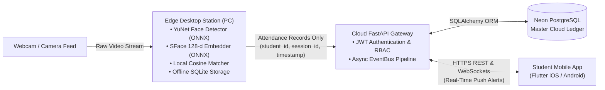
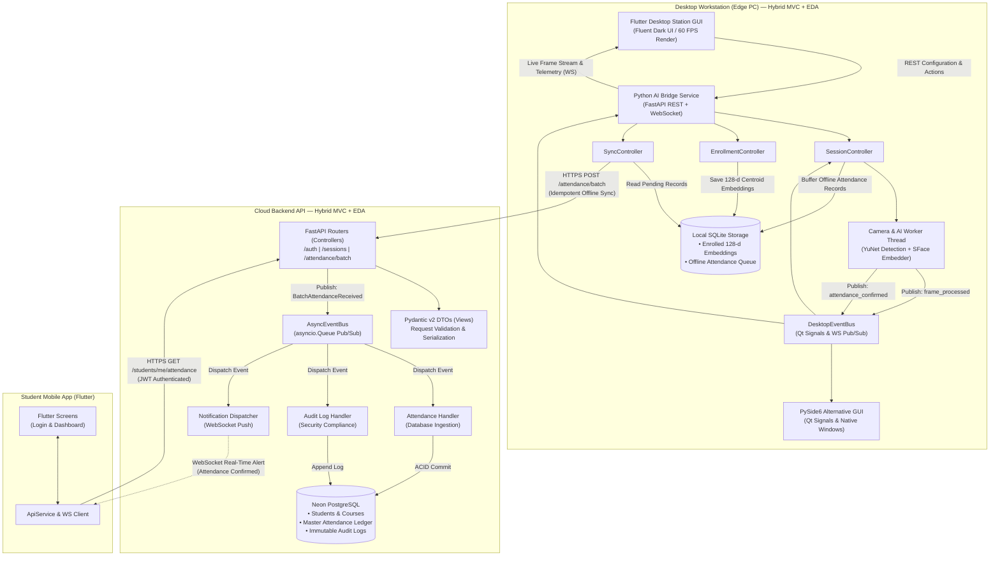
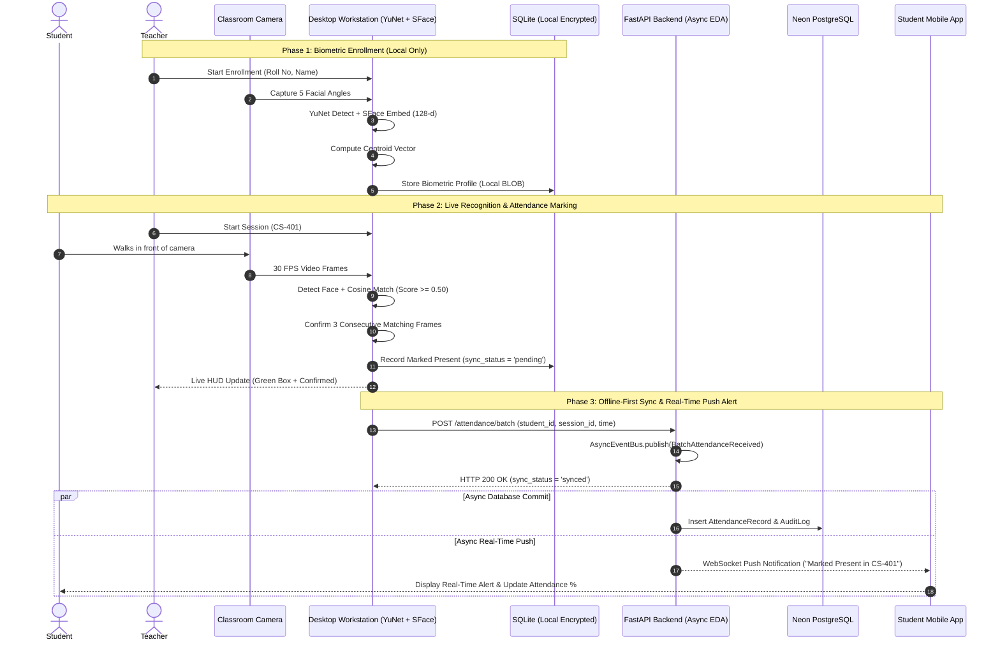

# 🎓 Focus: Privacy-Preserving Face Recognition Attendance System

[](focus.md)
[-green?style=for-the-badge)](desktop/)
[](desktop_flutter/)
[](backend/)
[](mobile/)
[](tests/)

---

## 📌 1. Overview & Core Philosophy

**Focus Attendance** is an automated, privacy-first facial recognition attendance system designed for educational institutions.

### 🛡️ Fundamental Design Principle
> **Biometric data never leaves the classroom PC.**  
> Face images and 128-dimensional embedding vectors are captured, stored, and matched **locally** inside an encrypted SQLite database on the Windows machine. The cloud backend **never** sees or stores biometric embeddings—it only receives minimal attendance records (`student_id`, `session_id`, `timestamp`, `method`, `confidence`).



---

## 🏗️ 2. System Architecture: Strict Hybrid (MVC + Event-Driven)

The system strictly adheres to a **Hybrid Architecture** combining **Model-View-Controller (MVC)** with an asynchronous **Event-Driven Architecture (EDA)** across both the **Edge Desktop Workstation** and the **Cloud Backend Platform**.



| Layer | Model | View | Controller | Event-Driven Mechanism |
|---|---|---|---|---|
| **Edge Desktop Station** | `LocalStorage` (SQLite) | `desktop_flutter` (Flutter Desktop) / `MainWindow` (PySide6) | `SessionController`, `SyncController`, `EnrollmentController` | `DesktopEventBus` + `CameraWorker` + WebSocket |
| **Cloud Backend** | SQLAlchemy (`models.py`) | Pydantic DTOs (`schemas.py`) | FastAPI Routers (`routers/`) | `AsyncEventBus` (`asyncio.Queue`) + Handlers |
| **Mobile Client** | `attendance_model.dart` | Flutter Widgets (`screens/`) | `ApiService` | WebSocket Push Receiver (`/ws/student/{id}`) |

---

### 🏛️ Detailed Architectural Breakdown: How Both Subsystems Work

The system is split into two primary subsystems that operate synergistically while maintaining strict boundaries of privacy and operational independence.

#### 1. Edge Desktop Workstation Subsystem (Local Offline-First AI Engine)

The desktop workstation is designed for local edge execution on the classroom PC. It guarantees zero cloud biometric leakage and functions seamlessly even during network outages.

* **Model Layer (`desktop/app/storage/local_db.py`):**
  * Powered by a local SQLite database (`desktop_attendance.db`).
  * Stores student profiles, class rosters, and 128-dimensional biometric embeddings serialized as binary BLOBs.
  * Implements an offline attendance buffer table with sync state tracking (`sync_status = 'pending' | 'synced'`).
  * **Privacy Guarantee:** Facial images and embedding vectors are strictly confined to this local file and are **never** transmitted across the network.

* **View Layer (`desktop_flutter/` & `desktop/app/ui/`):**
  * **Flutter Desktop Workstation (Primary):** Built with Flutter Windows runner, offering a 60 FPS hardware-accelerated interface with fluent neumorphic styling. Features a dynamic Camera HUD with real-time bounding box overlays, 5-sample biometric enrollment wizard, offline attendance ledger, and cloud diagnostics terminal.
  * **PySide6 Native GUI (Alternative):** A Qt-based desktop UI providing native widgets, camera feeds, and direct Qt Signal slots.

* **Controller Layer (`desktop/app/controllers/`):**
  * **`SessionController`:** Manages lecture session lifecycles, active student rosters, duplicate-marking guards, and confidence threshold validations.
  * **`EnrollmentController`:** Drives multi-angle facial sample captures (center, left, right, up, down), calculates normalized centroid embeddings ($\mathbf{v}_{\text{profile}} = \frac{1}{K} \sum_{k=1}^K \mathbf{v}_k$), and persists them into local SQLite.
  * **`SyncController`:** Monitors internet connectivity, bundles buffered attendance records into atomic batches, sends idempotent sync payloads to the Cloud API, and marks records as `synced` upon HTTP 200 acknowledgment.

* **Event-Driven Architecture (EDA) & Local Bridge (`desktop/app/events/` & `bridge_service.py`):**
  * **`CameraWorker`:** A dedicated background thread decoupled from the UI. Captures frames at 30 FPS, runs OpenCV **YuNet** face detection, extracts 128-d vectors via **SFace**, computes Cosine Similarity against enrolled students, and evaluates spatial bounding-box variance for anti-spoofing.
  * **`DesktopEventBus`:** Publishes `frame_processed` and `attendance_confirmed` events to listening controllers.
  * **`BridgeService`:** An ASGI bridge exposing REST control endpoints and a high-speed WebSocket stream (`/ws/camera`) that transmits annotated JPEG frames and recognition telemetry directly to Flutter Desktop with near-zero latency.

---

#### 2. Cloud Backend Platform Subsystem (Asynchronous Event-Driven Cloud Server)

The cloud backend provides centralized data aggregation, institutional reporting, role-based access control, and real-time push alerting.

* **Model Layer (`backend/app/models.py`):**
  * Built using SQLAlchemy ORM connected to Neon Serverless PostgreSQL (with fallback to SQLite in development).
  * Defines entities: `User` (RBAC: Admin, Teacher, Student), `Student`, `Course`, `Session`, `AttendanceRecord` (immutable attendance ledger with composite unique constraints on `[student_id, session_id]`), and `AuditLog` (append-only compliance trail).
  * **Zero Biometrics:** Schema completely omits face embeddings or biometric matrices.

* **View Layer (`backend/app/schemas.py`):**
  * Strongly-typed Pydantic v2 schemas providing automatic data validation, RFC 7519 JWT payload definitions, and clean JSON serialization.

* **Controller Layer (`backend/app/routers/`):**
  * **`auth.py`:** Bcrypt password hashing, OAuth2 password bearer flow, and JWT token issuance and verification.
  * **`sessions.py`:** Academic course session scheduling, active status tracking, and history queries.
  * **`attendance.py`:** Handles batch attendance ingestion from edge workstations (`POST /attendance/batch`) and student attendance history lookups.
  * **`students.py`:** Student self-service profile queries and course attendance percentage calculations.

* **Event-Driven Architecture (EDA) & Asynchronous Handlers (`backend/app/events/`):**
  * **`AsyncEventBus`:** Powered by Python's `asyncio.Queue` and non-blocking background workers.
  * When an edge workstation uploads an attendance batch, the controller publishes a `BatchAttendanceReceived` event to the bus and immediately returns HTTP 200/201 in under 10 ms without waiting for database writes.
  * **Concurrent Handlers:**
    1. **`AttendanceHandler`:** Asynchronously writes records to PostgreSQL within an ACID transaction, validating enrollment and enforcing uniqueness.
    2. **`AuditHandler`:** Appends security audit entries with IP address, timestamp, device identifier, matching method (`facial_recognition`), and confidence score.
    3. **`NotificationHandler`:** Dispatches real-time WebSocket push notifications to connected student mobile applications on `/ws/student/{id}`, notifying students the moment they are marked present.

---

#### 3. End-to-End Operational Workflows



---

## 🧠 3. Edge Biometric Pipeline

The local recognition pipeline is designed for high-speed CPU performance without requiring high-end GPUs:

1. **Detection:** OpenCV **YuNet** (`face_detection_yunet_2023mar.onnx`) running at 100+ FPS on CPU.
2. **Embedding:** OpenCV **SFace** (`face_recognition_sface_2021dec.onnx`) generating 128-d L2-normalized feature vectors.
3. **Centroid Enrollment:** Captures 5 sample frames per student with varied angles, computing an averaged centroid embedding: $\mathbf{v}_{\text{profile}} = \frac{1}{K}\sum \mathbf{v}_k$.
4. **Cosine Similarity Matching:** Measures vector distance against locally enrolled students with standard cosine threshold.
5. **Temporal Consecutive-Frame Confirmation:** Requires $N = 3$ consecutive frames of matching before officially confirming presence, eliminating momentary false positives.
6. **Liveness / Anti-Spoofing:** Tracks landmark micro-dynamics across frames to defeat static printed photo attacks.
7. **Offline-First Storage:** Records are stored in a local SQLite queue first. If internet drops, records buffer safely and sync automatically once online.

---

## 📂 4. Project Structure

```text
lab 3/
├── focus.md                        # Master product specification & requirements
├── README.md                       # Complete system documentation (this file)
├── run_desktop_flutter.bat         # One-click launcher for Flutter Desktop + AI Bridge
├── run_desktop.bat                 # PySide6 desktop launcher
│
├── desktop_flutter/                # Redesigned Flutter Desktop Workstation (Native Windows)
│   ├── pubspec.yaml                # Flutter desktop dependencies
│   ├── lib/
│   │   ├── main.dart               # Workstation entry point & role-based view orchestration
│   │   ├── theme.dart              # Fluent Neumorphic dark theme
│   │   ├── services/
│   │   │   └── bridge_client.dart  # REST & WebSocket client with authentication & offline demo mode
│   │   ├── widgets/
│   │   │   ├── sidebar.dart        # Station navigation, user profile card, role badge & log out
│   │   │   ├── top_bar.dart        # Role context & telemetry chips (Present, FPS, Sync Queue)
│   │   │   └── camera_stream_view.dart # High-FPS camera stream & AI HUD canvas
│   │   └── screens/
│   │       ├── login_screen.dart   # Role-based login (Admin, Teacher, Student) with 1-click demos
│   │       ├── live_monitoring_screen.dart   # Camera HUD, quick session controls, live roster (Admin/Teacher)
│   │       ├── enrollment_screen.dart        # 5-sample biometric registration & directory (Admin only)
│   │       ├── attendance_logs_screen.dart   # Offline queue verification & CSV export (Admin/Teacher)
│   │       ├── cloud_diagnostics_screen.dart # Cloud sync trigger & activity log terminal (Admin only)
│   │       └── student_attendance_screen.dart# Self-service student portal, KPI cards & personal CSV export
│   └── test/
│       ├── bridge_client_test.dart # Unit tests for BridgeClient
│       ├── enrollment_test.dart    # Biometric enrollment UI & form verification test
│       ├── role_auth_test.dart     # Role authentication, view isolation & logout test
│       └── widget_test.dart        # Desktop workstation integration & UI test suite
│
├── desktop/                        # Python Edge AI & Storage Engine
│   ├── prototype_recognition.py    # Step 1 Standalone Recognition Prototype
│   ├── requirements.txt            # Desktop dependencies (PyQt6/PySide6, OpenCV, ONNX, FastAPI)
│   ├── test_desktop_architecture.py# Desktop MVC + EventBus tests
│   ├── test_pipeline_and_storage.py# Biometric math, liveness, SQLite & bridge API tests
│   ├── test_role_auth_and_views.py # Role authentication, student isolation, & PyQt window tests
│   ├── models/                     # Downloaded ONNX Model weights
│   │   ├── face_detection_yunet_2023mar.onnx
│   │   └── face_recognition_sface_2021dec.onnx
│   └── app/
│       ├── main.py                 # PyQt6 native desktop application launcher
│       ├── bridge_service.py       # REST + WebSocket bridge for Flutter desktop
│       ├── recognition/            # Detection, embedding, matching, tracking, liveness
│       ├── storage/                # Local SQLite storage & offline queue
│       ├── controllers/            # SessionController, EnrollmentController, SyncController
│       ├── events/                 # DesktopEventBus (Qt Signals)
│       ├── ui/                     # PyQt6 views (login, live station, student portal)
│       └── workers/                # CameraWorker background inference thread
│
├── backend/                        # Cloud FastAPI Service
│   ├── requirements.txt            # Backend dependencies
│   ├── seed_data.py                # Database seeder (teachers, students, courses)
│   ├── test_eda.py                 # Backend Event-Driven Architecture test
│   ├── test_api_and_pipeline.py    # Comprehensive REST, JWT, sessions & batch tests
│   ├── .env.example                # Environment configuration
│   └── app/
│       ├── main.py                 # FastAPI entry point & CORS
│       ├── database.py             # Neon Postgres & dev SQLite engine
│       ├── models.py               # SQLAlchemy schema models
│       ├── schemas.py              # Pydantic v2 DTOs (ConfigDict)
│       ├── auth_utils.py           # Bcrypt & RFC 7519 compliant JWT management
│       ├── events/                 # AsyncEventBus & background subscriber loop
│       └── routers/                # Auth, Sessions, Attendance, Students
│
└── mobile/                         # Flutter Student Mobile App
    ├── pubspec.yaml                # Flutter mobile dependencies
    ├── test/
    │   └── mobile_auth_and_attendance_test.dart # Mobile integration & widget test suite
    └── lib/
        ├── main.dart               # Mobile entry point
        ├── models/                 # AttendanceHistoryItem, CourseSummary
        ├── services/               # ApiService with auto-host detection, offline demo, & WebSockets
        └── screens/
            ├── login_screen.dart   # Student login, 1-click demos & server configuration modal
            └── dashboard_screen.dart# Course summaries, 75% rule warnings, real-time alerts & search
```

---

## 🚀 5. Getting Started

### Step 1: Run the Standalone Recognition Prototype
Test the OpenCV YuNet + SFace camera pipeline with consecutive-frame confirmation:
```bash
python desktop/prototype_recognition.py
```

---

### Step 2: Run the Cloud Backend API
```bash
cd backend
python -m venv venv
venv\Scripts\activate
pip install -r requirements.txt

# Seed sample data (Prof. Alan Turing, CS-401, Alice, Bob, Charlie)
python seed_data.py

# Launch FastAPI
uvicorn app.main:app --reload --port 8000
```
* Interactive API Documentation: [http://localhost:8000/docs](http://localhost:8000/docs)
* Default Seeded Accounts:
  * **Teacher:** `teacher@school.edu` / `teacher123`
  * **Student:** `2024-CS-001` / `student123`

---

### Step 3: Run the Flutter Desktop Workstation (Production Ready)

Run the one-click launch script:
```powershell
.\run_desktop_flutter.bat
```
*Optional script arguments:*
* `.\run_desktop_flutter.bat` — Launches the compiled Windows Release binary.
* `.\run_desktop_flutter.bat --dev` — Compiles and runs live in development mode with `flutter run -d windows`.
* `.\run_desktop_flutter.bat --build` — Recompiles the Release binary with `flutter build windows` and launches.

#### Role-Based Authentication & Workstation Access:
The workstation features role-based access control with view isolation:
1. **Administrator Console (`admin` / `admin123`):**
   * View all attendance records across all courses and sessions.
   * Full access to 5-sample biometric enrollment via webcam (`desktop_attendance.db`).
   * Live camera monitoring and cloud database sync terminal.
2. **Teacher Station (`teacher` / `teacher123`):**
   * Configure and start/end class lecture sessions.
   * Real-time 30 FPS camera AI HUD (YuNet face detection + SFace matching + liveness indicator).
   * View student attendance logs and manual attendance override. Biometric enrollment is restricted.
3. **Student Portal (`2024-CS-001` or `2025(s)-SE-5` / `student123`):**
   * Personal self-service dashboard with 4 KPI summary cards (*Classes Attended*, *Latest Marked*, *Verification*, *Academic Standing*).
   * Filterable attendance history table and personal CSV report export. Camera HUD and enrollment are restricted.

---

### Step 4: Run the PySide6/PyQt6 Desktop Application (Alternative)
```bash
python desktop/app/main.py
```
*(or run `.\run_desktop.bat`)*
* Includes login screen, session controller, 3-consecutive-frame streak tracking, biometric enrollment, and student view isolation.

---

### Step 5: Run the Student Mobile App (Flutter)
```bash
cd mobile
flutter pub get
flutter run
```
*Or run as Windows desktop/web client:*
```bash
flutter run -d windows
```

#### Student Mobile Features:
* **Student Sign In & 1-Click Demo:** Sign in using Roll Number (`2024-CS-001` or `2025(s)-SE-5`) and password `student123`, or tap 1-click demo buttons.
* **Intelligent Host Auto-Detection & Server Settings:** Automatically connects to `http://10.0.2.2:8000` (Android emulator) or `http://127.0.0.1:8000` (Desktop/Web/iOS). A server settings modal lets students enter custom WiFi LAN URLs.
* **Offline Demo Fallback:** If the backend is offline, the app seamlessly provides realistic course summaries and verified logs.
* **Course Summaries & 75% Rule Warnings:** Displays per-course attendance progress bars with prominent warning badges for any course falling below the institutional 75% threshold.
* **Attendance History & Search:** Chronological log of all verified lectures, showing timestamp, verification method (Face Biometrics / Manual), match confidence percentages, and status chips.
* **Live Push Notifications (WebSockets):** Listens to `/ws/student/{id}` to display instant real-time celebration banners whenever attendance is confirmed in the classroom.

---

## 🧪 6. Rigorous Automated Test Suites (28 Tests Passing)

### 1. Python Cloud Backend Test Suite (`pytest`)
```powershell
pytest backend/test_api_and_pipeline.py backend/test_eda.py -v
```
- **7 passed** in ~4 seconds:
  - `backend/test_api_and_pipeline.py`: Health check, teacher & student JWT auth, session permissions, idempotent batch uploads, student self-service endpoints.
  - `backend/test_eda.py`: EventBus publish/subscribe, decoupled subscriber loops, and AuditLog commits.

### 2. Python Edge Desktop Test Suite (`pytest`)
```powershell
pytest desktop/test_desktop_architecture.py desktop/test_pipeline_and_storage.py desktop/test_role_auth_and_views.py -v
```
- **11 passed** in ~5 seconds:
  - `desktop/test_desktop_architecture.py`: Desktop MVC, signal buffering, and multi-face tracker streaks.
  - `desktop/test_pipeline_and_storage.py`: Cosine similarity math, anti-spoof liveness variance, SQLite queue, and FastAPI bridge service REST endpoints.
  - `desktop/test_role_auth_and_views.py`: Role authentication, biometric student login, student attendance query isolation, and PyQt6 window view gating.

### 3. Flutter Desktop Workstation Test Suite (`flutter test`)
```powershell
cd desktop_flutter
flutter test
```
- **9 passed** in ~18 seconds:
  - `test/bridge_client_test.dart`: Session state, camera streaming state, biometric enrollment/deletion, simulation matching, and cloud sync.
  - `test/enrollment_test.dart`: Biometric registration form inputs and directory table rendering.
  - `test/role_auth_test.dart`: End-to-end Admin, Teacher, and Student login verification, view isolation, and logout.
  - `test/widget_test.dart`: UI rendering, layout responsiveness, and workstation controls.

### 4. Flutter Student Mobile App Test Suite (`flutter test`)
```powershell
cd mobile
flutter test
```
- **1 passed (comprehensive suite)** in ~2 seconds:
  - `test/mobile_auth_and_attendance_test.dart`: Sign-in, 1-click demo access, summary KPI metrics, 75% threshold warning indicators, attendance logs timeline, live search filtering, and logout.

