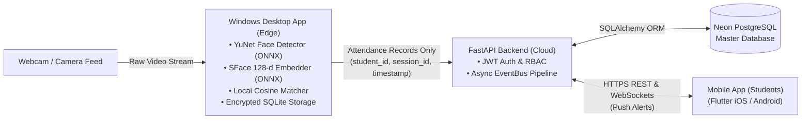

# Focus: Face Recognition Attendance System

Students are marked present automatically when they enter the classroom. A Windows desktop app runs face recognition locally on a camera feed. A mobile app lets students check their own attendance. A cloud Postgres database connects the two.

---

## 1. Overview

| Component | Purpose | Runs where |
|---|---|---|
| Windows app | Camera feed, face detection, recognition, enrollment, session control | Teacher's / classroom PC (local) |
| Backend API | Auth, stores and serves attendance records | Cloud |
| Postgres database | Students, classes, sessions, attendance | Neon (serverless Postgres) |
| Mobile app | Students view attendance history and percentages | Student phones |

**Design principle:** face images and embeddings never leave the Windows machine. Only attendance records (student ID, session, timestamp) are uploaded.

---

## 2. Architecture



The mobile app and the Windows app never talk to the database directly. Both go through the API, which enforces access rules. Biometric vectors and facial images never leave the local Windows machine.

---

## 3. Face Recognition Pipeline

No training or fine-tuning is needed to start. A pretrained model produces face embeddings, and students are **enrolled** by storing their embeddings.

1. **Detect** faces in each frame.
2. **Align and embed** each face into a 512-d (or 128-d) vector.
3. **Match** against enrolled embeddings using cosine similarity with a threshold.
4. **Confirm** only after the same student is recognized in N consecutive frames (e.g. 3-5) to avoid false positives.
5. **Mark present** once per student per session.

### Model choices (lightweight)

| Stage | Options |
|---|---|
| Detection | YuNet (OpenCV), SCRFD-500M, BlazeFace / MediaPipe |
| Recognition | MobileFaceNet, ArcFace with MobileNet backbone (InsightFace `buffalo_s`) |
| Quick prototype | `face_recognition` (dlib) |

Run models through **ONNX Runtime** (CPU is enough for a single classroom camera).

### Enrollment
- Capture 3-5 photos per student with varied angles and lighting.
- Store the averaged or individual embeddings locally (encrypted SQLite).
- Adding a student takes seconds, with no retraining.

### When to consider fine-tuning
Only if accuracy stays poor after fixing the basics: low light or resolution, masks, very large classes with look-alikes. First try better camera placement, more enrollment photos, and threshold tuning.

### Anti-spoofing
Add liveness detection (blink check or a lightweight anti-spoof model) so a photo of a classmate can't mark them present.

---

## 4. Windows App

**Stack:** Flutter Desktop (Primary Modern Workstation) / PySide6 (Qt Alternative) + Python, OpenCV, ONNX Runtime, SQLite.

**Screens**
- **Live session:** camera feed with face boxes, names, running present list, quick session controls
- **Enrollment:** capture photos, record 5 facial embeddings and save locally
- **Class setup:** pick class and start/end session
- **Records:** view, manually correct, export to CSV
- **Sync status:** shows pending and uploaded records

**Offline-first:** attendance is written to a local SQLite queue first and uploaded when internet is available, so a dropped connection never loses data.

---

## 5. Mobile App

**Stack:** Flutter (React Native is a fine alternative).

**Features**
- Login (student ID + password, or OTP)
- Attendance history by date and subject
- Attendance percentage per subject, with a warning below the minimum threshold
- Optional push notifications ("You were marked present in Physics")

Students can only see their own records.

---

## 6. Backend and Database

**Database:** Postgres on **Neon** (serverless, free tier, branching).
**API:** **FastAPI** (Python), deployed on Render, Railway, or Fly.io.

> Neon is plain Postgres: it has no built-in auth or client SDK for mobile, so the FastAPI layer is required. If you'd rather skip writing a backend, **Supabase** gives Postgres + auth + auto-generated API. **Firebase** is a different thing (NoSQL Firestore, not Postgres) and would change the data model.

### Schema (Postgres)

```sql
CREATE TABLE students (
    id            SERIAL PRIMARY KEY,
    roll_no       TEXT UNIQUE NOT NULL,
    full_name     TEXT NOT NULL,
    email         TEXT UNIQUE,
    password_hash TEXT NOT NULL,
    created_at    TIMESTAMPTZ DEFAULT now()
);

CREATE TABLE teachers (
    id            SERIAL PRIMARY KEY,
    full_name     TEXT NOT NULL,
    email         TEXT UNIQUE NOT NULL,
    password_hash TEXT NOT NULL
);

CREATE TABLE courses (
    id         SERIAL PRIMARY KEY,
    code       TEXT UNIQUE NOT NULL,
    name       TEXT NOT NULL,
    teacher_id INT REFERENCES teachers(id)
);

CREATE TABLE enrollments (
    student_id INT REFERENCES students(id) ON DELETE CASCADE,
    course_id  INT REFERENCES courses(id) ON DELETE CASCADE,
    PRIMARY KEY (student_id, course_id)
);

CREATE TABLE sessions (
    id         SERIAL PRIMARY KEY,
    course_id  INT REFERENCES courses(id) ON DELETE CASCADE,
    started_at TIMESTAMPTZ NOT NULL,
    ended_at   TIMESTAMPTZ
);

CREATE TABLE attendance (
    id         SERIAL PRIMARY KEY,
    session_id INT REFERENCES sessions(id) ON DELETE CASCADE,
    student_id INT REFERENCES students(id) ON DELETE CASCADE,
    marked_at  TIMESTAMPTZ NOT NULL,
    method     TEXT DEFAULT 'face',      -- 'face' or 'manual'
    confidence REAL,
    UNIQUE (session_id, student_id)       -- one mark per session
);
```

### API endpoints (draft)

| Method | Endpoint | Used by | Purpose |
|---|---|---|---|
| POST | `/auth/student/login` | Mobile | Student login, returns JWT |
| POST | `/auth/teacher/login` | Windows | Teacher login, returns JWT |
| GET | `/me/attendance` | Mobile | Own attendance history |
| GET | `/me/summary` | Mobile | Percentage per course |
| POST | `/sessions` | Windows | Start a session |
| PATCH | `/sessions/{id}/end` | Windows | End a session |
| POST | `/attendance/batch` | Windows | Upload queued records (idempotent) |
| PATCH | `/attendance/{id}` | Windows | Manual correction |

### Access rules
- Students: read-only, own records only.
- Teachers (Windows app): create sessions, write attendance for their own courses.
- The database is never exposed directly to clients.

---

## 7. Privacy and Security

- Get explicit consent before enrolling anyone: this is biometric data.
- Keep embeddings on the local machine only, encrypted at rest; avoid storing raw photos.
- Hash passwords (argon2 or bcrypt), use short-lived JWTs, HTTPS everywhere.
- Keep database credentials in environment variables, never in the app or repo.
- Define a retention policy and a way to delete a student's data on request.

---

## 8. Suggested Project Structure

```
focus/
├── README / focus.md
├── run_desktop_flutter.bat   # One-click Flutter desktop launcher
├── run_dektop_flutter.bat    # Alias launcher
├── run_dektop_flutter.app    # Shell/batch launcher
├── run_desktop.bat           # PySide6 desktop launcher
├── desktop_flutter/          # Modern Flutter Desktop Workstation (Native Windows)
│   ├── lib/                  # Screens (Live HUD, Enroll, Logs, Cloud Sync) & widgets
│   ├── test/                 # Automated Flutter unit & widget test suite
│   └── pubspec.yaml
├── desktop/                  # Python Edge AI & Storage Engine
│   ├── app/
│   │   ├── bridge_service.py # REST + WebSocket bridge for Flutter desktop
│   │   ├── ui/               # PySide6 UI screens
│   │   ├── recognition/      # detector, embedder, matcher, liveness, tracker
│   │   ├── storage/          # local SQLite, sync queue
│   │   └── main.py
│   ├── models/               # ONNX model files
│   └── requirements.txt
├── backend/                  # FastAPI Cloud API & EDA
│   ├── app/
│   │   ├── routers/
│   │   ├── events/           # EventBus and background handlers
│   │   ├── models.py
│   │   ├── schemas.py
│   │   └── main.py
│   └── requirements.txt
└── mobile/                   # Student Mobile App (Flutter)
```

---

## 9. Build Order

1. **Recognition prototype:** a Python script with webcam enrollment and matching. Tune the threshold.
2. **Windows UI:** wrap it in PySide6 with enrollment and live session screens.
3. **Local storage:** SQLite, CSV export. At this point it works as a standalone system.
4. **Backend:** Neon database, FastAPI, auth, and the sync endpoint.
5. **Sync:** upload queued attendance from the Windows app.
6. **Mobile app:** login, history, percentages, notifications.
7. **Hardening:** liveness detection, error handling, logging, packaging, testing in a real classroom.

---

## 10. Practical Tips

- **Camera placement matters more than model choice:** mount it at the door, at face height, with good lighting.
- Require several consecutive-frame matches before marking present.
- Provide manual override for teachers; no recognition system is perfect.
- Log recognition confidence so the threshold can be tuned with real data.
- Test with varied lighting, glasses, haircuts, and similar-looking students.

---

## 11. Open Questions

- Hardware for the Windows machine (CPU only, or GPU available)?
- Expected class size and number of simultaneous entries?
- Is liveness detection required from day one?
- Will teachers need a web dashboard in addition to the Windows app?
- Minimum attendance percentage rules per institution?
